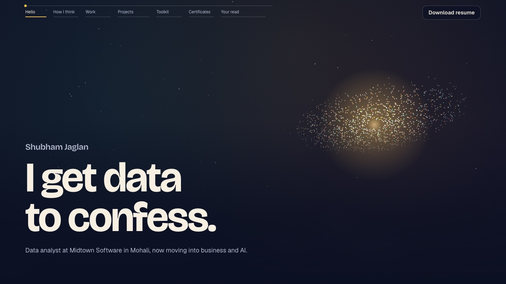
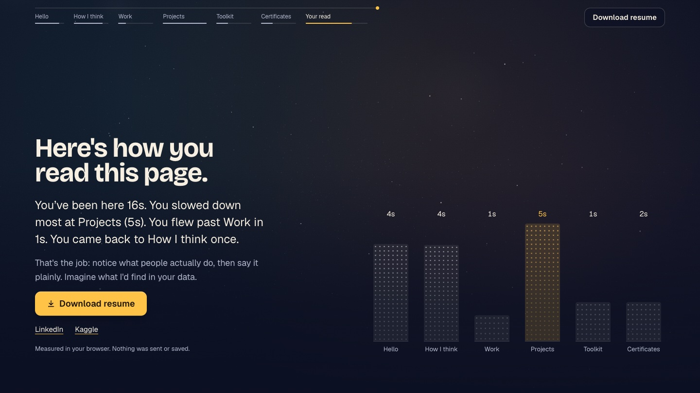

# Shubham Jaglan · Portfolio

**Live site → [shubhamjaglan20.github.io](https://shubhamjaglan20.github.io)**

Data analyst at Midtown Software, moving into business and AI. This is my portfolio: one page you fly through, where a night sky of data points rearranges itself at every stop.

## The stops

| Stop | What the sky does |
|---|---|
| Hello | A warm light with a swarm around it that dodges your cursor |
| How I think | Scattered points sort themselves into four neat columns |
| Work | A road to the horizon with my three roles along it |
| Projects | California housing price prediction, then a COVID-19 curve |
| Toolkit | Four spinning rings, one per skill group |
| Certificates | Fifteen stars joined in date order |
| Your read | Every point flies into a chart of how **you** just read the page |

The ending is measured live in your browser (time per stop, what you skipped, what you came back to). Nothing is sent or saved anywhere.

## Built with

Plain HTML, CSS and JavaScript. The sky is drawn on a canvas in real time: no framework, no video, no build step. Scroll timing runs on the scrollcraft engine.

## Elsewhere

[LinkedIn](https://www.linkedin.com/in/shubham-506-jaglan) · [Kaggle](https://www.kaggle.com/shubhamjaglan001)
